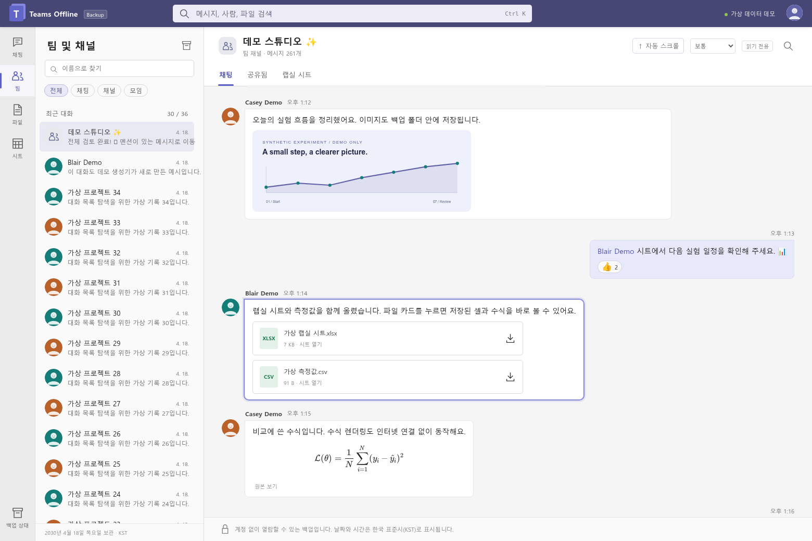
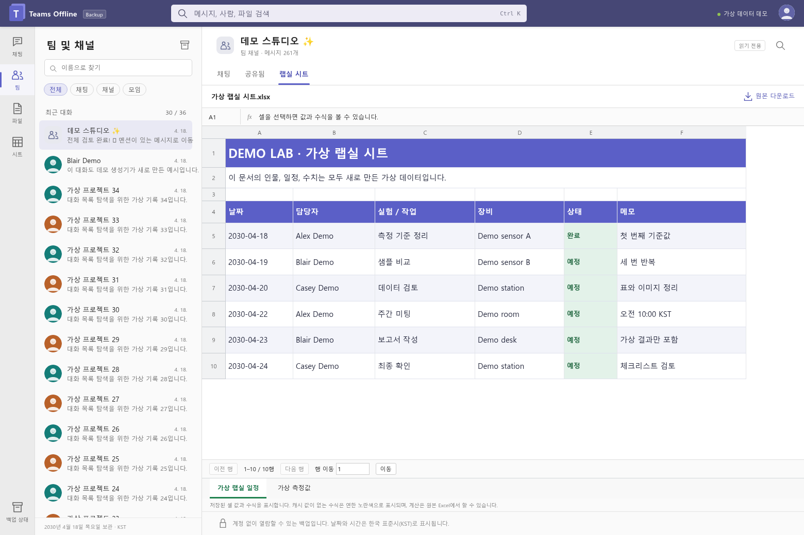
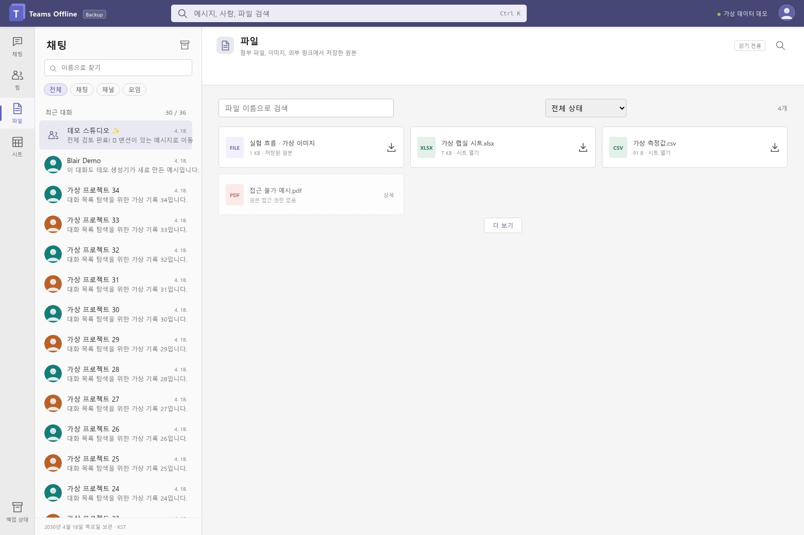

# Teams Offline Backup

Back up Teams conversations, attachments, images, and spreadsheets locally, then read them without an account. The offline viewer provides a Teams-like interface with search, mention navigation, rendered math, and spreadsheet previews.

**This repository contains the software and a newly generated synthetic demo only. It includes no real Teams conversations, Microsoft account details, profile photos, organization documents, or login sessions.**

This is an independent community project, not a Microsoft product. The viewer currently uses Korean UI labels and Korean Standard Time (KST).



## Try the demo

Download or clone the repository, then **open `demo/index.html` in Chrome or Edge.** Viewing the demo requires no installation, login, server, or internet connection. Download the entire folder: GitHub's file preview does not run the HTML application.

- 3 fictional users, 36 conversations, and 297 messages
- Original SVG profile illustrations, a fictional experiment image, and a sample lab spreadsheet
- An intentionally unavailable file demonstrating how access failures appear
- Invented links and identifiers that do not come from real accounts or organizations

## Features

| Area           | Capabilities                                                                                                                |
| -------------- | --------------------------------------------------------------------------------------------------------------------------- |
| Conversations  | Chat, meeting, and channel inventory; paginated message collection; resume and refresh                                      |
| Files          | Message attachments, Teams media, linked SharePoint document libraries, and optional OneDrive collection                    |
| External links | Direct file downloads, public document export URLs, recorded access failures, and manual file import                        |
| Interface      | Teams-like navigation, full-text search, 30 recent conversations with a load-more button, and independent sidebar scrolling |
| Navigation     | Mentions open a direct or related conversation; quotes and archived Teams message links jump to the original message        |
| Content        | Local avatars and images, emoji and reactions, readable system events, and partial Adaptive Card support                    |
| Math           | Offline LaTeX and chemistry rendering with bundled KaTeX and mhchem                                                         |
| Spreadsheets   | XLSX/XLSM/XLS/CSV originals, plus previews of cells, formulas, merged ranges, basic styles, and embedded images             |
| Dates          | `Asia/Seoul` timestamps, Korean AM/PM and relative date labels, and full-date tooltips                                      |
| Auto-scroll    | Scroll toward older messages at four speeds, load earlier history automatically, and stop on manual interaction             |
| Verification   | SHA-256 and size checks, collection coverage reports, and an unavailable-file list                                          |



## Installation

Requires Node.js 22 or later and Python 3.10 or later. The exporter is designed for Windows, macOS, and Linux; automated checks run with Chromium on Linux. WSL requires WSLg or another display environment for the login window.

```bash
git clone https://github.com/refracta/teams-offline-backup.git
cd teams-offline-backup
npm ci
npx playwright install chromium
python3 -m venv .venv
.venv/bin/python -m pip install -r requirements.txt
```

In Windows PowerShell, replace the last two commands with:

```powershell
py -3 -m venv .venv
.venv\Scripts\python.exe -m pip install -r requirements.txt
```

On Linux, use `npx playwright install --with-deps chromium` if browser system libraries are missing. See the [Playwright installation documentation](https://playwright.dev/docs/intro) for environment requirements. The CLI automatically uses the repository's `.venv`; set `TEAMS_PYTHON` to use another Python executable.

## Back up your account

```bash
# Complete Microsoft sign-in in the dedicated browser window.
node bin/teams-backup.cjs login

# Keep real data outside the source repository.
node bin/teams-backup.cjs backup --output ../my-private-teams-archive

# Review collection coverage and file integrity.
node bin/teams-backup.cjs verify --output ../my-private-teams-archive
```

Open **`index.html` in the output directory** when the backup finishes. Copy the entire output folder to read it on another computer. Passwords and tokens do not need to be entered in source code or command-line arguments. The dedicated login profile is stored separately in your operating system's user data directory.

By default, the exporter collects messages, attachments, discovered Teams document libraries, and directly downloadable external files. Add `--onedrive` to include your discovered OneDrive drive, or `--external all` to attempt downloads from general external links as well. External folders and NAS roots are retained as addresses and are not copied recursively.

**Review `verification.html` and `unavailable-files.csv`.** Matching file hashes confirm the integrity of saved files; collection coverage must be reviewed separately. Exit code `2` means the archive has items that need review, while `1` indicates an execution error. The synthetic demo intentionally includes an unavailable file in its verification report.

The **[backup guide (Korean)](docs/backup-guide.md)** covers resuming interrupted runs, checks before account expiration, external services, lab spreadsheets, and manual exports.

## Commands

| Command                                           | Purpose                                                                               |
| ------------------------------------------------- | ------------------------------------------------------------------------------------- |
| `login`                                           | Save an interactive sign-in in the dedicated browser profile                          |
| `backup --output PATH`                            | Collect messages and files, then build the viewer; rerun with the same path to resume |
| `backup --output PATH --refresh`                  | Traverse all message pages again and refresh files                                    |
| `build --output PATH`                             | Rebuild the viewer and spreadsheet previews from existing data without network access |
| `verify --output PATH`                            | Check file sizes and hashes, message artifacts, and collection coverage               |
| `import-file --output PATH --key KEY --file FILE` | Associate a manually exported file with an archived link                              |
| `demo`                                            | Regenerate the synthetic demo without an account                                      |

Run `node bin/teams-backup.cjs --help` for options.

## Scope and limitations

The collector uses internal APIs observed in the signed-in Teams web client. **It is experimental: API changes or organization policies may prevent some data from being collected.** Organizations needing an official bulk export solution can also consult the [Microsoft Teams Export API documentation](https://learn.microsoft.com/en-us/microsoftteams/export-teams-content).

- Deleted or inaccessible originals cannot be recovered. Failures and incomplete inventories are recorded in the reports.
- External service logins, dynamic web applications, Microsoft Lists and Forms, OneNote, and Loop editing interfaces are not fully replicated. Save accessible originals or export PDF/XLSX/CSV files manually and import them.
- Spreadsheet previews show saved cell values and formulas. They do not include an Excel calculation engine, macro execution, or chart reconstruction. Formulas without cached results are displayed as formulas.
- Recording thumbnails are identified separately from original videos. Downloading a thumbnail does not mean the recording itself has been saved.
- The viewer works without external network access. Opening an original link or a document in another application follows that application's behavior and connection settings.
- Message refreshes retain earlier raw pages. Full file version histories are not collected.



## Development and demo generation

```bash
npm run demo
npm test
npm run test:viewer
npm run screenshots
npm run check:privacy
```

`test:viewer` checks KST formatting, search, mentions, quotes, auto-scroll, and spreadsheets using `file://` in an offline browser configured with a US time zone. `screenshots` captures only the synthetic demo and accepts no real browser profile or archive path.

[Development and privacy separation (Korean)](docs/development.md) · [Archive format (Korean)](docs/archive-format.md) · [Third-party notices](THIRD_PARTY_NOTICES.md)

## License

The software and synthetic demo are licensed under [MIT](LICENSE). KaTeX and Noto Emoji retain their included upstream licenses. The Microsoft Teams name is used to describe product compatibility.
